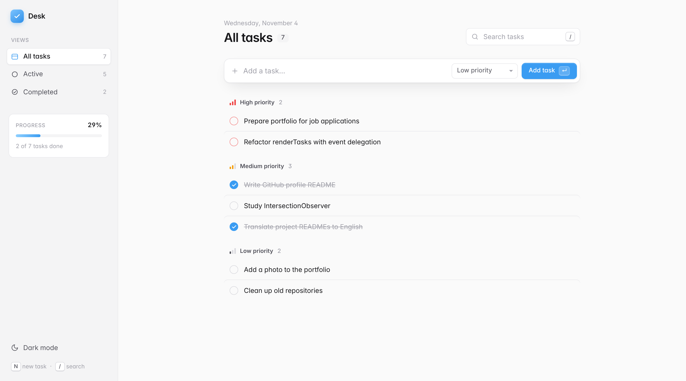

# Desk — Task Manager

A task manager inspired by modern productivity apps, built with **HTML, CSS and vanilla JavaScript** (Bootstrap only for the modals).

Create, edit and complete tasks, group them by priority, track your progress and move around with keyboard shortcuts. Everything is saved locally in the browser, with a persistent light/dark theme.

## Live website
https://simonesbds.github.io/task-manager/



---

## Features

- Create, edit (modal) and delete (confirmation modal) tasks
- Mark tasks as completed
- Tasks grouped by priority (High / Medium / Low)
- Sidebar views: All / Active / Completed, each with a live counter
- Progress bar showing how many tasks are done
- Text search
- Keyboard shortcuts: <kbd>N</kbd> new task, <kbd>/</kbd> search, <kbd>Esc</kbd> leave the field
- Persistent light/dark theme
- Data saved in localStorage
- Responsive layout: the sidebar becomes a top bar on small screens
- Respects the user's "reduce motion" setting

---

## Tech Stack

- HTML5
- CSS3 (custom properties for theming, CSS Grid, Flexbox)
- JavaScript (vanilla)
- LocalStorage API
- Bootstrap 5 (modals only)

---

## Project Structure

```
task-manager/
├── index.html    # layout: sidebar, composer, list, modals
├── global.css    # design tokens, light/dark themes, components
├── app.js        # state, CRUD, rendering, stats, shortcuts
├── image.png     # preview
├── favicon.ico, favicon-32x32.png, apple-touch-icon.png
├── LICENSE
└── README.md
```

---

## JavaScript Concepts Used

- DOM manipulation
- Event handling (including global keyboard shortcuts)
- Array methods (`filter`, `find`, `forEach`)
- Application state management
- LocalStorage
- Template literals
- Derived data (counters and progress computed from the task list)
- `Intl` date formatting with `toLocaleDateString`
- Bootstrap modals via JavaScript

---

## License

Distributed under the MIT License. See [LICENSE](LICENSE) for details.
